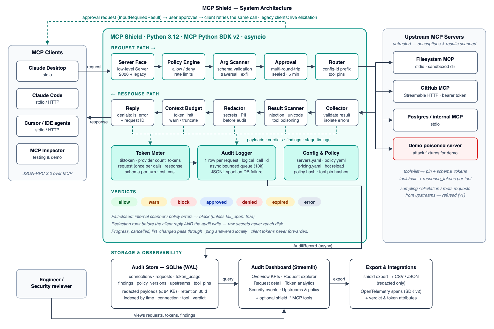
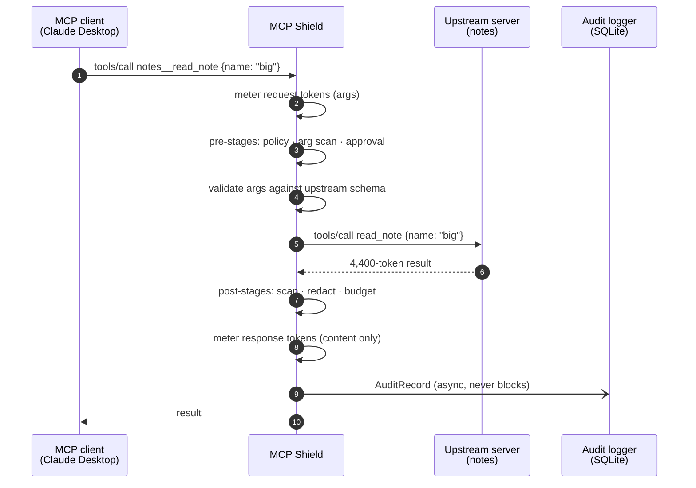
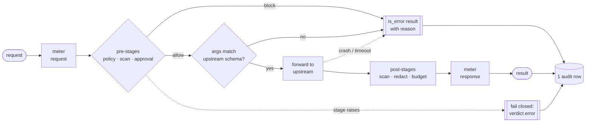
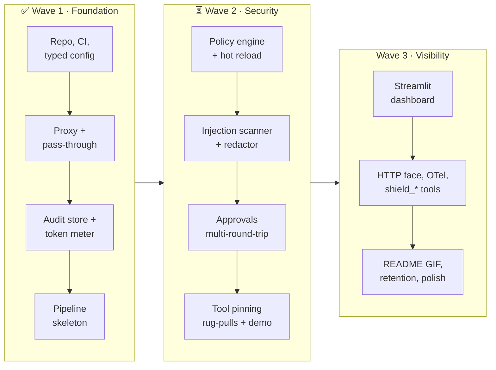

<div align="center">

# 🛡️ MCP Shield

**A security and observability gateway for Model Context Protocol servers.**
Every tool call your agent makes is routed, checked, metered and audited, with its token cost.


</div>

---

## Why

Agents are being wired to third-party MCP servers faster than anyone can vet them. Tool descriptions and tool outputs flow straight into the model's context, and today nobody can answer:

> **What did the agent call, what came back, was it safe, and how much context did it cost?**

MCP Shield sits between any MCP client (Claude Desktop, Claude Code, Cursor, MCP Inspector) and your MCP servers. To the client it is one MCP server; to each upstream it is a client. In between, every request goes through a pipeline that records it.

## Architecture



The **request path** (top row) runs every call through policy, argument checks and approval before routing it upstream. The **response path** (second row) validates, scans, redacts and budgets the result before the model sees it. Every stage reports to the **token meter** and the **async audit logger**, which writes one row per JSON-RPC request to SQLite.

> The diagram shows the full v1 design. Wave 1 (this release) ships the proxy, pipeline skeleton, token meter and audit; the security stages plug into the pipeline in wave 2. See the [roadmap](#roadmap).

### One tool call, end to end



### Guarantees built into the pipeline



- **Exactly one audit row per request.** Allowed, blocked, failed and unknown-tool calls alike. A test fires 1,000 mixed requests and checks for 1,000 rows.
- **Fail closed.** If a pipeline stage crashes, nothing is forwarded and the verdict is `error`.
- **The model reads the reason.** Gateway denials are `is_error` tool results with a readable message, not protocol errors only the client app sees.
- **Isolated upstreams.** A server that's down, slow or malformed never breaks the others.
- **No raw secrets on disk.** Payload storage stays off until the redactor lands (wave 2).

## Token usage, the headline feature

MCP messages don't carry LLM usage, so Shield meters what it *can* see and control: **the context tokens contributed by MCP traffic.**

| Field | What is counted | Why it matters |
|---|---|---|
| `request_tokens` | Canonical JSON of the tool arguments | What the model generated to make the call |
| `response_tokens` | The result `content` the model receives (`structuredContent` isn't counted twice) | Oversized tool outputs are a silent context hog |
| `schema_tokens` | Name + description + schemas of listed tools | A standing cost on **every** model turn, per server |
| `est_cost_usd` | Total × your input price from `pricing.yaml` | Optional; always labelled an estimate |

Counts use `tiktoken` (`o200k_base`) offline, fall back to a len/4 heuristic, and every row records which tokenizer produced it.

## Quickstart

```bash
# 1. Install (needs uv: https://docs.astral.sh/uv/)
git clone <this repo> mcp-shield && cd mcp-shield
uv sync

# 2. Validate the example config
uv run shield check --config examples/shield.yaml

# 3. Drive Shield the way an MCP host does (stdio subprocess), then read the audit
make demo
```

Real output from `make demo`:

```text
connected to mcp-shield over stdio · protocol 2026-07-28

tools/list → 4 tools: notes__echo, notes__add, notes__read_note, notes__slow_count
tools/call notes__echo        → ok    hello through the shield
tools/call notes__add         → ok    {"result": 42}
tools/call notes__read_note   → ok    Token-heavy tool output can quietly eat your context window. …
tools/call notes__add         → ERROR [MCP Shield] Blocked: arguments don't match notes__add's input schema: a: 'twenty' is not …
tools/call notes__read_note   → ERROR Error executing tool read_note: no note named 'missing'; try one of ['big', 'welcome']

MCP Shield audit · examples/shield-audit.db
  requests 6 · blocked/errors 1 · tokens 4,824 (estimated) · est. cost $0.0145

  Top tools by response tokens
    notes__read_note                     2 calls     4,421 tok      8.5 ms avg
    notes__add                           2 calls         9 tok      2.4 ms avg
    notes__echo                          1 calls         4 tok      6.8 ms avg

  Last 15 requests
    14:44:00.104  tools/call       notes__read_note             allow         26 tok     11.7 ms
    14:44:00.088  tools/call       notes__add                   block         10 tok      0.4 ms
    14:44:00.084  tools/call       notes__read_note             allow      4,405 tok      5.2 ms
    14:44:00.074  tools/call       notes__add                   allow         18 tok      4.4 ms
    14:44:00.016  tools/call       notes__echo                  allow         12 tok      6.8 ms
```

Notice the `block` row: Shield refused to forward arguments that didn't match the upstream's schema, and the model got a readable reason. The second `read_note` is the upstream tool's own error, passed through unchanged.

### Use it from Claude Desktop or Claude Code

Replace your individual server entries with one Shield entry. **Claude Desktop** (`claude_desktop_config.json`):

```json
{
  "mcpServers": {
    "shield": {
      "command": "uv",
      "args": ["--directory", "/path/to/mcp-shield", "run", "shield", "run", "--config", "examples/shield.yaml"]
    }
  }
}
```

**Claude Code:**

```bash
claude mcp add shield -- uv --directory /path/to/mcp-shield run shield run --config examples/shield.yaml
```

Then list your real servers in `examples/servers.yaml`. The `id` becomes the tool prefix (`fs__read_file`, `github__create_issue`).

## Configuration

| File | Purpose |
|---|---|
| [`shield.yaml`](examples/shield.yaml) | Audit DB, tokenizer, paths to the files below |
| [`servers.yaml`](examples/servers.yaml) | Upstream servers (stdio or HTTP). HTTP upstreams use their **own** credentials; the client's token is never forwarded |
| [`policy.yaml`](examples/policy.yaml) | Allow/deny rules, approvals, rate limits, context budget (validated now, enforced from wave 2) |
| [`pricing.yaml`](examples/pricing.yaml) | Input-token price for the estimated cost column |

Config errors point at the exact line, and `${VAR}` / `${VAR:-default}` are expanded from the environment:

```text
$ uv run shield check --config shield.yaml
servers.yaml:8: environment variable ${GITHUB_MCP_TOKEN} is not set

$ uv run shield check --config shield.yaml
servers.yaml:2: servers.0: Input tag 'carrier-pigeon' found using 'transport' does not match any of the expected tags: 'stdio', 'http'
```

`uv run shield schema` writes JSON Schemas for editor autocompletion.

## CLI

| Command | What it does |
|---|---|
| `shield run -c shield.yaml` | Serve over stdio (what MCP hosts launch) |
| `shield check -c shield.yaml` | Validate all config files; exit code 2 on errors |
| `shield stats -c shield.yaml` | Totals, top tools by tokens, latest requests |
| `shield schema` | Export JSON Schemas for the config files |

## Protocol support

Built on the **MCP Python SDK v2** low-level `Server`. A single process serves **2026-07-28** clients (no session, per-request metadata) and **legacy 2025-11-25** clients at the same time. Every integration test runs against both.

| Message | Shield's behaviour |
|---|---|
| `tools/*`, `resources/*`, `prompts/*` | Aggregated across upstreams, namespaced, metered, audited |
| Progress (server → client) | Relayed from the upstream to the calling client |
| `ping` (legacy) | Answered by Shield; never forwarded (removed in 2026-07-28) |
| Upstream elicitation / sampling / roots | Refused in v1; elicitation attempts are recorded as `passthrough.backchannel_refused` |
| Upstream `list_changed` (legacy upstreams) | Re-list, re-snapshot, notify connected clients |

## Roadmap



| Wave | Tasks | Status |
|---|---|---|
| **1 · Foundation** | TS-A1 repo/CI · TS-A2 config · TS-A3 proxy · TS-A4 pass-through · TS-A5 audit · TS-A6 token meter · TS-A7 pipeline | ✅ Done (A1 awaits its first CI run) |
| **2 · Security** | Policy engine, injection scanner, redactor, approvals, context budget, tool pinning, demo kit | ⏳ Next |
| **3 · Visibility** | Dashboard, export, HTTP face, OpenTelemetry attributes, `shield_*` audit tools | Planned |

## Project layout

```text
src/mcp_shield/
  config.py            typed YAML config, env expansion, line-numbered errors
  app.py               wiring: meter → audit → upstream pool → pipeline → server
  cli.py               `shield` command (run · check · stats · schema)
  proxy/
    server_face.py     low-level SDK v2 Server: what clients connect to
    upstream_pool.py   one SDK Client per upstream, isolated, refusing back-channel requests
    router.py          {config_id}__name namespacing + upstream definition checks
  pipeline/
    pipeline.py        ordered stages, fail-closed, denials as is_error results
    context.py         per-request state + stage timers
  metering/            tokenizers + meter (request / response / schema tokens)
  audit/               SQLite store, migrations, async logger with JSONL spool
demo/                  demo upstreams (benign + misbehaving) and the stdio driver
tests/                 unit + integration (in-memory SDK client, both protocol revisions)
docs/prd/              the full PRD set (Markdown + PDF + architecture diagram)
```

## Development

```bash
make check    # ruff lint + format check, mypy --strict, pytest
make cov      # tests with coverage
make format   # auto-format
```

## Documentation

The full product requirements live in [`docs/prd/`](docs/prd/):
[Master plan](docs/prd/master-plan.md) ·
[Implementation plan](docs/prd/implementation-plan.md) ·
[Design guideline](docs/prd/design-guideline.md) ·
[User journeys](docs/prd/user-journey.md) ·
[Tasks & evidence](docs/prd/tasks.md) ·
[PDF](docs/prd/MCP-Shield-PRD.pdf)

Known deviations from the PRD in wave 1 are listed under *Wave 1 implementation notes* in [`tasks.md`](docs/prd/tasks.md#6-evidence-log).
