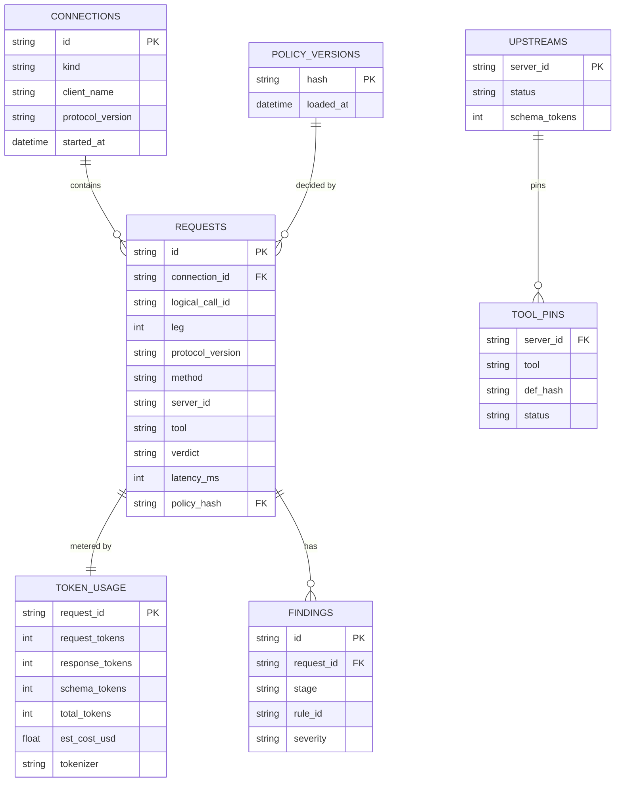
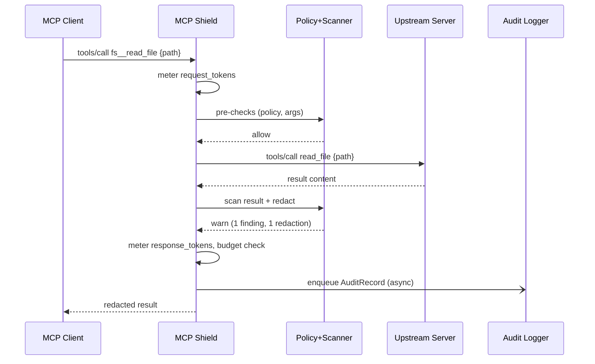
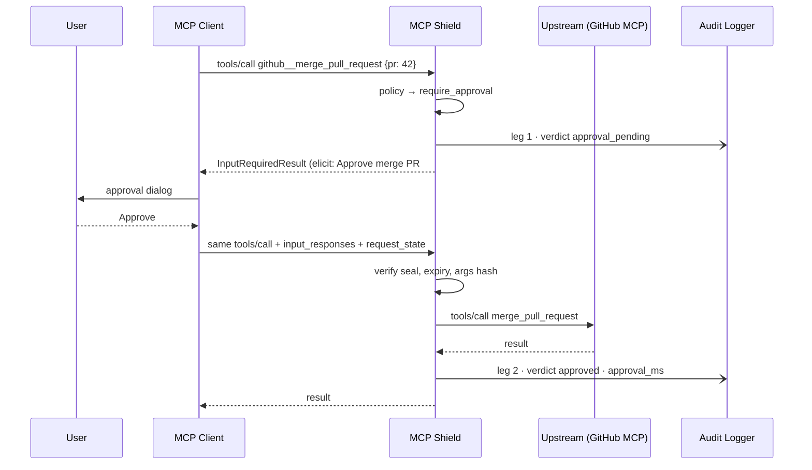

# Implementation Plan — MCP Shield

This document turns the master-plan baseline into technical decisions: system boundaries, the request pipeline, token metering, interfaces, schema, and verification. Read it after Gate 1 and before `tasks.md`.

## Reference note

Reusable refs use the prefix `IP-<SectionLetter><Number>`.

## 1. Orientation and Intended Reader

- Intended readers: the author/implementer, coding agents, and reviewers.
- This file answers: how the proxy is structured, where state lives, how every request is intercepted, metered and audited, and how each slice is verified.
- Read after: `master-plan.md`
- Read next: `design-guideline.md`, `user-journey.md`, then `tasks.md`

## 2. Core Concepts and Boundaries

| Boundary | Owned here | Inputs | Outputs | Main failure mode | Source refs |
|---|---|---|---|---|---|
| **IP-A1** Downstream server face (Shield-as-server) | Yes | JSON-RPC from clients over stdio or Streamable HTTP, on 2026-07-28 or legacy 2025-11-25 | Aggregated tools/resources/prompts, responses, approval requests (`InputRequiredResult`, or live elicitation for legacy clients) | Client disconnect mid-call | MP-B1, MP-B5 |
| **IP-A2** Upstream connector pool (Shield-as-client) | Yes | `servers.yaml` entries | One SDK `Client` per upstream, keyed by config id; health status; validated tool inventory | Upstream crash / auth failure / malformed responses | MP-B1, MP-C9 |
| **IP-A3** Security pipeline (policy → scanner → approval → redactor) | Yes | Normalized `RequestContext` | Verdict + findings + possibly modified payload | Rule crash → fail closed | MP-B2–B5, MP-C5 |
| **IP-A4** Token meter | Yes | Request params, response content, list results | `TokenUsage` record | Tokenizer unavailable → fallback char/4, flagged | MP-B6, MP-C1 |
| **IP-A5** Audit logger + store | Yes | `AuditRecord` | SQLite rows | Disk full / lock → spool to JSONL, alert | MP-B6, MP-C2 |
| **IP-A6** Dashboard | Yes | SQLite (read-only connection) | Web pages, CSV/JSON export | Large-table slowness | MP-B7 |
| **IP-A7** Upstream MCP servers | No | Tool calls | Results | Malicious descriptions/results | MP-B3 |
| **IP-A8** Provider `count_tokens` API | No (optional) | Text | Exact token count | No key / network → use tiktoken | MP-C1 |

### System architecture

<!-- ARCH_SVG -->

*Figure 1. System-level architecture. The request path runs left to right along the top row and the response path runs right to left along the second row. Every stage reports to the async audit logger.*

### Boundary rules

- **IP-A9** Shield never forwards a request upstream before policy and scanning have run. Responses never reach the client before output scanning and redaction have run.
- **IP-A10** The audit write is asynchronous, through a bounded `asyncio.Queue` of 10k items, so it never blocks the request path. If the queue is full, records spill to `audit-spool.jsonl` and are back-filled later. MP-C2 holds because no record is dropped.
- **IP-A11** Pass-through matrix:
  - **Forwarded and audited** with `method` only and zero token fields: server→client `progress`, `cancelled`, and change notifications (`list_changed`, or `subscriptions/listen` events on 2026-07-28). Every upstream `list_changed` also triggers a re-scan and re-pin (IP-A16).
  - **Answered locally, never forwarded:** `ping` from legacy clients. `ping` is removed in 2026-07-28.
  - **Refused:** requests that an upstream sends to the client (`sampling/createMessage`, `elicitation/create`, `roots/list`). Shield's upstream `Client` registers no callbacks for them, so the upstream gets an error. These features are removed or deprecated in 2026-07-28, and relaying them is a v2 growth bet. The refusal is audited with finding `passthrough.backchannel_refused`.
  - **Not forwarded:** protocol logging (deprecated). Shield logs to stderr.
- **IP-A12** Tool names are namespaced as `{config_id}__{tool}`, where the prefix is the `servers.yaml` id, never the upstream's self-reported `serverInfo.name` (MP-C9). Shield strips the prefix before calling upstream. Aggregated names stay within 128 characters of `[A-Za-z0-9_.-]`; an upstream tool whose prefixed name would be longer is dropped and reported in P6.
- **IP-A13** SDK v2 behaviors the proxy must handle:
  - The low-level `Server` **does not validate tool arguments**, so Shield validates arguments against the upstream's `inputSchema` before forwarding.
  - **Outgoing results are validated.** One upstream tool with an invalid schema (for example `{}` without `"type": "object"`) would fail the whole aggregated `tools/list`, so each upstream tool is validated and invalid ones are dropped and reported.
  - **The upstream `Client` validates what it receives** and raises `ValidationError` on malformed responses. Each upstream call is isolated, so one bad server never breaks the others.
  - An unexpected exception in a handler becomes a generic `-32603` the model never sees, so every expected failure is handled explicitly (IP-A15).
- **IP-A14** Shield never forwards client credentials upstream (MP-C8). Over HTTP it binds to `127.0.0.1` by default, validates the `Origin` header, and enforces a Host allowlist (`transport_security`) against DNS rebinding.
- **IP-A15** Policy and scanner denials are returned as `CallToolResult(is_error=True)` with the reason text and `_meta.shield = {verdict, rule_id, request_id}`, so the model can read them (MP-C10). `MCPError` is used only for auth failures, rate limits and malformed requests, which go to the client app.
- **IP-A16** Tool pinning: on every listing Shield hashes each tool's name, description, schemas and annotations (SHA-256 of canonical JSON). A new tool is pinned. A changed hash means a rug-pull candidate: the tool is re-scanned, a `tool_changed` finding is recorded, and with `on_change: require_approval` its next call needs approval.
- **IP-A17** Annotations only tighten (MP-C7): `destructiveHint: true` adds `require_approval` when `defaults.approve_destructive: true`; `readOnlyHint` never removes a rule.

## 3. Behavior-to-Boundary Mapping

| User job or workflow slice | Trigger | Frontend boundary | Server boundary | Data changes | External dependencies | Verification anchor |
|---|---|---|---|---|---|---|
| J1 Connect & aggregate | Client `initialize` / `tools/list` | Client UI | IP-A1 → IP-A2 fan-out `list_tools` | `sessions` row; `requests` row with `schema_tokens` | Upstream servers | I: in-memory client sees `demo__echo`, `fs__read_file` |
| J2 Safe tool call | `tools/call` | Client | IP-A3 full pipeline → IP-A2 | `requests`, `findings`, `token_usage` | Upstream | I: poisoned fixture → `block`; benign → `allow` |
| J2 Description poisoning | `tools/list` response | Client | Scanner on descriptions; poisoned tools hidden or marked | `findings` with `target=description` | Upstream | I: hidden tool absent from list |
| J3 Approval | Policy `require_approval` | Client approval dialog | IP-A3 approval stage returns `InputRequiredResult` with a sealed `request_state`; client retries the same call with the answer (legacy: live `elicitation/create`) | Two `requests` rows sharing a `logical_call_id`; verdict `approval_pending`, then `approved` / `denied` / `expired`; `approval_ms` | Client elicitation capability | I: modern and legacy clients accept/decline; tampered or expired `request_state` is rejected |
| Rug-pull detection | Upstream tool definition changes | P5, P6 | Pinning on listing (IP-A16) | `tool_pins` updated; `tool_changed` finding | Upstream | I: fixture server mutates a description mid-session → flagged and re-scanned |
| J4 Audit & tokens | Any request | Dashboard P1–P5 | IP-A4, IP-A5, IP-A6 | Read-only | — | I: N requests → N rows; token totals match fixture |
| J5 Policy reload | File change | CLI / P6 | Watcher → validate → atomic swap | `policy_versions` row | — | I: invalid YAML keeps old policy, logs error |

## 4. API and Schema Direction

### Request pipeline (per JSON-RPC request)

```text
1. receive        → RequestContext{request_id, connection_id, protocol_version, logical_call_id, method, server_id, tool, params, t0}
2. meter.request  → request_tokens = count(json(params))
3. policy.pre     → allow | deny(rule) | require_approval | rate_limited
4. scanner.args   → findings on arguments (path traversal, shell metachars, exfil URLs)
5. approval       → if required and no valid answer attached:
                     return InputRequiredResult(elicit: summary, request_state=sealed{logical_call_id, args_hash, exp=now+5m})
                     (legacy client: live elicitation instead). On the retry: verify seal, expiry and args_hash
                     ⇒ approved | denied | expired
6. validate+fwd   → validate args against upstream inputSchema, then upstream.call_tool(tool, params)   (timeout per server)
7. scanner.result → findings on result content (injection phrases, hidden unicode, markdown-image exfil)
8. redactor       → mask secrets/PII; findings(type=redaction)
9. meter.response → response_tokens = count(content as seen by model); schema_tokens for list calls
10. budget        → if response_tokens > budget: warn | truncate (configurable)
11. decide        → final verdict (worst-of rules)
12. audit.enqueue → AuditRecord (redacted payload, verdict, findings, tokens, latency, policy_hash)
13. respond       → client: the result, or an is_error tool result with the reason (IP-A15). MCPError only for auth, rate-limit and malformed requests
```

### Token metering design (headline feature)

**IP-B1** — MCP messages carry no LLM usage data. Shield meters the *context tokens contributed by MCP traffic*. This is the part an engineer controls: tool-description bloat and oversized tool outputs.

| Field | What is counted | When | Notes |
|---|---|---|---|
| `request_tokens` | Canonical JSON of `params.arguments` (or full `params` for non-tool methods) | First leg of each logical call; 0 on an approval retry | What the model generated to call the tool, counted once |
| `response_tokens` | Text of `result.content[]` (text parts verbatim; images counted with a fixed per-image estimate). `structuredContent` is **not** counted again, because compliant tools also return it as text. It is counted only when `content` is empty | `tools/call`, `resources/read`, `prompts/get` | What lands in the model context |
| `schema_tokens` | Name + description + `inputSchema` (+ `outputSchema`) per tool, and prompts/resources | Recorded on each listing and stored per server in `upstreams` | A **standing cost on every model turn**. Shield can't see turns, and v2 clients cache listings using `ttlMs` hints, so P4 shows the latest snapshot per server, not a sum of list traffic |
| `total_tokens` | Sum of the above | Every request | — |
| `est_cost_usd` | `total_tokens × price_per_token` from `pricing.yaml` (input rate) | Every request | Optional; shown only if pricing is configured |
| `tokenizer` | e.g. `tiktoken:o200k_base` or `provider:count_tokens` | Every request | MP-C4 |

- Sampling is not metered. Upstream sampling requests are refused in v1 (IP-A11).
- A `Tokenizer` protocol with `count(text) -> int` has three implementations: `TiktokenTokenizer` (default), `ProviderCountTokens` (async, cached by hash), and `CharHeuristic` (fallback, ÷4).
- Counting runs in a thread pool for payloads over 32 KB so the event loop stays free.
- A calibration test compares the tiktoken counts with provider counts on the fixture corpus and asserts the ratio stays within ±10% (MP success marker).

### Interface direction

| Interface | Caller | Contract summary | Auth / permission rule | Failure contract | Source refs |
|---|---|---|---|---|---|
| MCP stdio | Claude Desktop / Code | Standard MCP, both revisions; `command: shield run --config shield.yaml` | Local process | Denials: `is_error` tool result + `_meta.shield = {verdict, rule_id, request_id}` (IP-A15) | MP-B1, MP-C10 |
| MCP Streamable HTTP `POST /mcp` | Remote clients | Standard MCP, both revisions | Bearer token from env `SHIELD_TOKEN` (v1 static); bind `127.0.0.1`; `Origin` + Host allowlist; client token never forwarded | 401 on bad token; 403 on bad Origin/Host | MP-B1, MP-C8, IP-A14 |
| `shield_*` audit tools (optional) | The agent itself | `shield_list_requests`, `shield_get_token_usage`, `shield_list_security_events`; `readOnlyHint: true`; `limit` (default 20, max 100) + `cursor` with `has_more`; `response_format: markdown or json`; `outputSchema` + `structuredContent` | Same as the connection | `is_error` with a suggested next step (for example "narrow the time range") | MP-B7 |
| `shield run` | Engineer | Starts proxy (+ optional `--dashboard`) | — | Exit code 2 on invalid config with line numbers | J1 |
| `shield check-policy FILE` | Engineer / CI | Validates YAML + dry-runs fixtures | — | Non-zero on schema error | J5 |
| `shield export --from --to --format csv\|json` | Reviewer | Dumps audit rows (redacted) | Local file access | — | MP-B7 |
| Dashboard `GET /` (Streamlit :8501) | Reviewer | Read-only pages P1–P6 | Localhost bind by default | Empty states when DB missing | MP-B7 |

### Config shapes

```yaml
# servers.yaml
servers:
  - id: fs
    transport: stdio
    command: ["npx", "-y", "@modelcontextprotocol/server-filesystem", "./sandbox"]
  - id: github
    transport: http
    url: https://example.internal/mcp
    headers: { Authorization: "Bearer ${GITHUB_MCP_TOKEN}" }
  - id: evil            # demo-only poisoned server
    transport: stdio
    command: ["python", "-m", "demo.poisoned_server"]
```

```yaml
# policy.yaml
version: 1
defaults: { action: allow, scan_results: warn, fail_open: false }
context_budget: { per_call_tokens: 4000, on_exceed: warn }   # warn | truncate
approval: { token_ttl: 300s, approve_destructive: true }     # destructiveHint can only tighten
pinning: { on_change: require_approval }                     # warn | block | require_approval
rules:
  - id: deny-write-outside-sandbox
    match: { server: fs, tool: write_file }
    when: { arg: path, not_glob: "./sandbox/**" }
    action: deny
  - id: approve-destructive
    match: { tool: ["delete_*", "*_merge", "drop_*"] }
    action: require_approval
  - id: rate-limit-github
    match: { server: github }
    rate_limit: { calls: 30, per: 60s }
scanner:
  description_action: block      # poisoned tool descriptions are hidden
  result_action: warn            # results: warn + redact by default
  classifier: { enabled: false, threshold: 0.85 }
```

### Entity and schema direction

| Entity or table | Purpose | Key fields | Relationships | Lifecycle notes | Source refs |
|---|---|---|---|---|---|
| `connections` | How a client reaches Shield (stdio process, legacy `Mcp-Session-Id`, or grouped 2026-07-28 HTTP traffic) | `id`, `kind` (stdio / legacy_session / grouped), `client_name`, `client_version`, `protocol_version`, `capabilities`, `started_at`, `last_seen_at` | 1→N requests | Closed on disconnect or after 30 min idle | MP-C2 |
| `requests` | **One row per JSON-RPC request** | `id`, `connection_id`, `logical_call_id`, `leg` (1 or 2), `protocol_version`, `jsonrpc_id`, `direction`, `method`, `server_id`, `tool`, `verdict`, `error_code`, `latency_ms`, `upstream_ms`, `approval_ms`, `params_redacted` (≤64 KB), `result_redacted` (≤64 KB), `payload_truncated`, `policy_hash`, `shield_version`, `created_at` | N→1 session; 1→1 token_usage; 1→N findings | Retention: `retention_days` (default 30) | MP-B6, MP-C2, MP-C4 |
| `token_usage` | Token metrics per request | `request_id`, `request_tokens`, `response_tokens`, `schema_tokens`, `total_tokens`, `est_cost_usd`, `tokenizer`, `estimated` | 1→1 request | Immutable | MP-B6, MP-C1 |
| `findings` | Rule hits | `id`, `request_id`, `stage` (policy/args/description/result/redaction/budget), `rule_id`, `severity`, `target`, `snippet_hash`, `excerpt_redacted` | N→1 request | Immutable | MP-B3, MP-B4 |
| `policy_versions` | Policy history | `hash`, `loaded_at`, `source_path`, `yaml_redacted` | 1→N requests (by hash) | Append-only | MP-C4 |
| `upstreams` | Health snapshot | `server_id`, `status`, `tool_count`, `dropped_tools` (invalid/too long), `schema_tokens`, `last_error`, `checked_at` | 1→N tool_pins | Upserted every 30 s | J1, IP-A13 |
| `tool_pins` | Rug-pull detection | `server_id`, `tool`, `def_hash`, `first_seen_at`, `last_changed_at`, `status` (pinned / changed / hidden) | N→1 upstream | Updated on every listing | MP-B3, IP-A16 |

Indexes: `requests(created_at)`, `requests(connection_id)`, `requests(logical_call_id)`, `requests(server_id, tool, created_at)`, `requests(verdict, created_at)`, `findings(rule_id)`.

### Schema sketch



### Tool-call sequence (with metering and audit)



### Approval sequence (multi-round-trip, 2026-07-28)



A legacy (2025-11-25) client gets the same question as a live `elicitation/create` within a single request. The SDK's `Resolve` + `Elicit` handles both.

### Package layout

```text
mcp_shield/
  proxy/        server_face.py (low-level Server), upstream_pool.py, router.py, passthrough.py, validate.py, pins.py
  pipeline/     context.py, policy.py, scanner/ (rules.yaml, heuristics.py, classifier.py), redactor.py, approval.py, budget.py
  metering/     tokenizer.py, meter.py, pricing.py
  audit/        models.py, logger.py (queue + spool), store.py, retention.py, export.py
  dashboard/    app.py, pages/ (overview, explorer, detail, tokens, security, upstreams)
  tools/        shield_tools.py (optional read-only shield_* MCP tools)
  telemetry.py  adds Shield attributes to the SDK's OpenTelemetry spans
  cli.py        Typer entry point
demo/           benign_server.py, poisoned_server.py, attack_fixtures/, claude_desktop_config.json
tests/          unit/, integration/ (in-memory Client, modern and mode="legacy"), fixtures/
evals/          shield_tools_eval.xml (10 read-only questions, mcp-builder format)
```

## 5. Integration and Verification

| Slice | Static checks | Integration checks | E2E checks | Fixtures or seeds | Evidence |
|---|---|---|---|---|---|
| Proxy & aggregation | ruff, mypy | In-memory client ↔ Shield ↔ 2 in-memory upstreams, run with both a modern and a `mode="legacy"` client; list + call + pass-through matrix; malformed upstream tool dropped without breaking `tools/list` | Claude Desktop manual smoke | `benign_server`, `fs` sandbox, `malformed_server` | Test output, screenshot of tools list |
| Upstream identity & pinning | Unit: hashing, prefixing | Upstream reporting `serverInfo.name="fs"` still gets its config prefix; description mutated mid-session → `tool_changed` | Demo: rug-pull | `rugpull_server` | Test output |
| Policy engine | Unit: rule matching, globs, rate limiter clock-injected | Deny/approve paths over protocol | — | `policy.test.yaml` | pytest report |
| Scanner & redactor | Unit per rule (positive + negative) | 12 attack fixtures + 50 benign samples | Demo: poisoned server blocked | `attack_fixtures/*.json` | Precision/recall table in README |
| Approval | Unit: seal/verify, expiry, args-hash mismatch | Modern client (multi-round-trip) and legacy client (live elicitation): accept / decline / no capability; tampered or expired `request_state` rejected; 2 rows share `logical_call_id`, args counted once | Claude Desktop approval dialog | — | Screen recording |
| HTTP hardening | — | 401 without token; 403 on foreign `Origin`/Host; client `Authorization` never reaches upstream (header capture) | MCP Inspector | — | Test output |
| `shield_*` tools | Unit: pagination, formats | `outputSchema` validated; `has_more` cursor works | 10-question evaluation run | Seeded DB | Eval report |
| Token metering | Unit: counts for text/image/structured content | Calibration vs provider `count_tokens` (skipped without key) | P4 totals equal SQL sum | Token corpus | Calibration report |
| Audit completeness | Unit: record builder | Fire 1,000 mixed requests incl. errors/blocks → assert 1,000 rows; kill DB → spool → backfill | — | Load script | Count assertion output |
| Dashboard | Unit: query layer | Seeded DB renders all pages without error (Streamlit `AppTest`) | Manual demo walkthrough | `seed_audit.py` (5k rows) | Screenshots |
| Overhead | — | Benchmark: p95 added latency ≤ 25 ms | — | Echo server | Bench output |

### Rollout and operations notes

- Ship SQLite migrations as plain SQL in `audit/migrations/` and apply them on startup.
- `make demo` runs `docker compose up` with Shield, the dashboard, the benign server, the poisoned server, and the seeded DB.
- Shield logs to stderr as structured JSON, because stdout is reserved for the stdio MCP transport.

## 6. Open Risks and Follow-up Links

| Topic | Risk or open question | Proposed next move | Linked refs |
|---|---|---|---|
| Proxy fidelity | Resolved: build on the low-level `Server` (v2). The remaining risk is serving two revisions at once | Run the full integration suite on both revisions | IP-A11, IP-A13 |
| Grouping 2026-07-28 HTTP traffic | Without a session, grouping by client info + token is a heuristic | Show `kind=grouped` in the UI; never use it for security decisions | MP-C (Connection) |
| `request_state` across workers | The default seal key is per process | v1 runs one process; set `RequestStateSecurity(keys=[...])` before scaling out | IP pipeline step 5 |
| Image token estimate | Per-image cost varies by model | Configurable constant; labelled estimate | IP-B1, MP-C6 |
| Description blocking | Hiding tools may confuse users | Show hidden tools in P6 with reason | DG-P6, UJ-C2 |

### Gate 2 contribution check

- [x] No technical choice contradicts `master-plan.md`.
- [x] No new stack beyond MP Section 5.
- [x] Interfaces, data direction, and verification anchors are concrete.
- [x] Cross-links to design and journey docs exist.
