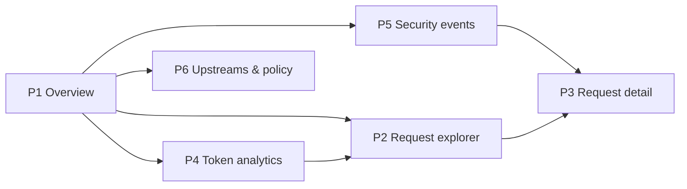

# Master Plan — MCP Shield

This document locks the baseline for MCP Shield v1. It defines the users, scope, domain language, stack baseline, page model, and design taste that all downstream docs honor. Read this first to know what is being built, for whom, and which stack and visual direction are in bounds.

| Field | Value |
|---|---|
| Product | MCP Shield — security & observability gateway for Model Context Protocol servers |
| Version | PRD v1.1 (template set: `Weihan96/PRD-templates` · `template/v4`) |
| Protocol target | MCP **2026-07-28** and legacy **2025-11-25** clients, both served at once · MCP Python SDK **v2** |
| Date | 2026-11-18 |
| Status | Gate 1 — draft for approval |
| Target release | v1 portfolio release (≈ 3 weeks) |

### Revision history

| Version | Date | Change |
|---|---|---|
| v1.0 | 2026-11-18 | First Gate 1 draft |
| v1.1 | 2026-11-18 | Revised after MCP review. Approval now uses multi-round-trip requests instead of server push. Session renamed to connection. Ping and sampling dropped. Proxy built on the low-level SDK `Server`. Added protections: upstream identity from config, annotations can only tighten, tool pinning against rug-pulls, HTTP hardening, denials returned as tool results. OpenTelemetry moved into v1. Optional `shield_*` audit tools and an evaluation suite added. |

## Reference note

Reusable refs use the prefix `MP-<SectionLetter><Number>` (Section 1 = A, 2 = B, …).

## 1. Purpose and Users

### Product one-liner

**MP-A1** — MCP Shield is a drop-in proxy that sits between any MCP client (Claude Desktop, Claude Code, Cursor) and one or more MCP servers. It **blocks prompt-injection and tool-poisoning attacks, enforces per-tool policies, asks a human before risky calls, and records every MCP request in an audit log with its token usage**. It exists now because teams are wiring agents to third-party MCP servers faster than they can vet them, and today nobody can answer "what did the agent call, what came back, and how much context did it cost?"

### Reader outcome

After reading this file, a teammate or coding agent should be able to answer:

- What is in scope for v1: the proxy, the security pipeline, a per-request audit with token usage, and a read-only dashboard.
- Which users matter most: the AI engineer who connects MCP servers, then the security reviewer.
- Which stack and design direction are the default: Python, the official MCP SDK, SQLite, and Streamlit, in a calm security-console style.
- Which pages and jobs downstream docs must elaborate.

### User segments

| Segment | Priority | Current pain | Desired outcome | Notes |
|---|---|---|---|---|
| AI / GenAI engineer wiring MCP servers into an agent | `P0` | Installs community MCP servers blind; tool descriptions and outputs flow straight into the model's context; no record of calls or token cost | One config change routes all MCP traffic through Shield; sees blocked attacks and per-call token cost | Works locally, mostly CLI + Claude Desktop / Claude Code |
| Security / platform reviewer | `P1` | Can't audit what agents did with tools; no allow/deny controls | Searchable audit trail, policy file in git, exportable evidence | Reads the dashboard and exports; does not run agents |
| Recruiter / hiring manager (demo audience) | `P2` | Needs to understand the project in < 3 minutes | Live demo: poisoned server blocked, audit row appears with tokens | Drives the "demo mode" requirement |

## 2. Scope and Non-goals

### In-scope outcomes

| Area | Must ship | Why now | Out of scope boundary |
|---|---|---|---|
| **MP-B1** Proxy & aggregation | Shield is an MCP server to clients and an MCP client to N upstream servers (stdio + Streamable HTTP). It serves both protocol revisions (2026-07-28 and legacy 2025-11-25) from one process. Tools, resources and prompts are aggregated as `{config_id}__{name}`, and the prefix always comes from `servers.yaml`, never from the upstream | Foundation for everything else | No load balancing or HA clustering. No relay of upstream sampling, elicitation or roots requests in v1: they are refused with a clear error |
| **MP-B2** Policy engine | YAML allow/deny per server/tool, argument rules (regex / path globs), rate limits, `require_approval` flag. Upstream tool annotations can only tighten policy (MP-C7) | Least-privilege for agent tools | No GUI policy editor (YAML in git only) |
| **MP-B3** Injection & poisoning scanner | Scans tool **descriptions** on `tools/list` and tool **results** on `tools/call` using heuristic rules plus an optional local classifier; verdict is `allow`, `warn`, or `block`. **Tool pinning:** Shield hashes every tool definition. A definition that changes later (a "rug-pull") is re-scanned, flagged `changed`, and can require approval on its next use | Tool poisoning and rug-pulls are the leading MCP attack classes | No guaranteed detection, no LLM-based scanning in v1 |
| **MP-B4** Output redaction | Masks secrets (API keys, JWTs, private keys) and PII (email, phone) in results before they reach the model | Prevents data leakage into context and logs | No custom DLP dictionaries |
| **MP-B5** Human approval | Calls flagged `require_approval` return an **approval request** (`InputRequiredResult`, via the SDK's `Resolve` + `Elicit`). The client asks the user and **retries the same call** with the answer. Legacy clients get a live elicitation instead. Approval tokens are sealed and expire after 5 minutes | Human-in-the-loop for destructive tools | No multi-approver workflows. No server-side waiting: the 2026-07-28 protocol has no server-to-client requests |
| **MP-B6** Request audit + token usage | **Every** JSON-RPC message pair (request + response/error) is logged with connection, protocol version, server, method, tool, verdict, latency, and **token usage**: request tokens, response tokens, tool-schema tokens, and an estimated cost. The two legs of an approved call share a `logical_call_id`, so its arguments are counted once | The headline feature: full traceability and context-cost visibility | No billing integration; tokens are *estimated* (see MP-C1) |
| **MP-B7** Audit dashboard + audit tools | Read-only web UI: overview KPIs, request explorer, request detail, token analytics, security events; CSV/JSON export. Optional read-only MCP tools (`shield_list_requests`, `shield_get_token_usage`, `shield_list_security_events`), so you can ask the agent about its own audit | Makes the audit usable and demoable | No user accounts or RBAC in v1 |
| **MP-B9** Tracing | Use the SDK's built-in OpenTelemetry spans and add Shield attributes (verdict, rule IDs, token counts, upstream) | Free GenAI-observability signal; spans already follow the GenAI conventions | No hosted tracing backend; OTLP export only |
| **MP-B8** Demo kit | `make demo` boots Shield, a benign server, and a deliberately poisoned server, with Claude Desktop config snippets | Recruiter-friendly 2-minute demo | No hosted multi-tenant demo |

### Non-goals

- A hosted SaaS, multi-tenancy, SSO, or RBAC.
- Measuring the model's own reasoning and output tokens. MCP traffic doesn't carry LLM usage, so Shield meters only what passes through it (see MP-C1).
- Scanning with LLMs, or detection that adapts automatically. v1 rules are deterministic and testable.
- Modifying or forking upstream MCP servers.
- Relaying requests that upstream servers send to the client (sampling, elicitation, roots). The 2026-07-28 revision removes or deprecates these, so v1 refuses them with a readable error.
- `ping` keepalives. `ping` is removed in 2026-07-28; Shield answers legacy pings locally and never forwards them.
- Being a policy marketplace or a public registry of server reputation.

### Success markers

| Horizon | Signal | Target or threshold |
|---|---|---|
| `Launch` | Demo poisoned-server attack blocked end-to-end | 100% of the 12 seeded attack fixtures blocked or warned |
| `Launch` | Audit completeness | 100% of JSON-RPC requests have an audit row (verified by test harness count) |
| `Launch` | Proxy overhead | p95 added latency ≤ 25 ms per `tools/call` (excluding approval wait) |
| `Launch` | Token estimate accuracy | Within ±10% of provider `count_tokens` on the fixture corpus |
| `30 days` | Portfolio signal | README demo GIF, ≥ 85% test coverage on `policy/`, `scanner/` and `audit/`, CI green |

## 3. Core Concepts and Domain Terms

| Term | Stable definition | Used by which user/job | Must not be confused with |
|---|---|---|---|
| **Client** | The MCP host/client app (Claude Desktop, Claude Code, Cursor) that connects to Shield | Engineer | The LLM itself |
| **Upstream server** | An MCP server Shield connects to on the client's behalf, declared in `servers.yaml` | Engineer, reviewer | "Backend" (too vague) |
| **Connection** | How a client reaches Shield, with a `connection_id`. For stdio it is the process lifetime. For legacy HTTP it is the `Mcp-Session-Id`. For 2026-07-28 HTTP there is no session, so Shield groups requests by client info + auth token + 30-minute idle window | All audit views | "Session", which 2026-07-28 removes; upstream connections |
| **Request** | One JSON-RPC message from client → Shield and its paired response or error. It records `protocol_version` | Audit, dashboard | "Event" (UI grouping of requests) |
| **Logical call** | One tool call as the user understands it. Usually one request; an approved call is two (the approval request, then the retry). Linked by `logical_call_id` | Audit, token metering | Request |
| **Tool pin** | The hash of a tool's name, description, schemas and annotations when Shield first saw it | Security events, P6 | Policy |
| **Verdict** | The outcome of the security pipeline for a request: `allow`, `warn`, `block`, `approved`, `denied`, `error` | Reviewer | HTTP status |
| **Finding** | One rule hit from the scanner or redactor (rule id, severity, snippet hash) attached to a request | Reviewer | Verdict (a request may have many findings, one verdict) |
| **Policy** | The versioned YAML rules (`policy.yaml`) applied to requests; each audit row stores the policy hash | Engineer, reviewer | Scanner rules (detect) vs policy (decide) |
| **Token usage** | **MP-C1** — The *estimated* number of LLM tokens carried by MCP payloads: `request_tokens` (arguments, counted once per logical call), `response_tokens` (the result `content` the model receives; `structuredContent` is not counted again), `schema_tokens` (tool/prompt/resource definitions: a standing cost on every model turn, taken from the latest listing). Counted with a configurable tokenizer and flagged `estimated=true` | Engineer, dashboard | Billed API tokens of the model's own reasoning/output |
| **Context budget** | A configurable maximum `response_tokens` per call or per session; above it Shield warns or truncates | Engineer | Rate limit (count of calls) |

### Invariants

- **MP-C2** — Every request that reaches Shield produces exactly one audit row, including blocked, denied, timed-out and errored requests. The audit write happens even when the upstream server is down.
- **MP-C3** — Redaction runs before both the client response *and* the audit write. Raw secrets never go to disk.
- **MP-C4** — Every audit row records `policy_hash`, `tokenizer` and `shield_version`, so a past decision can be explained later.
- **MP-C5** — When the scanner or policy engine itself crashes, the request **fails closed** (`block`, verdict `error`) unless `fail_open: true` is set explicitly.
- **MP-C6** — Token counts are estimates and are always labelled as such in the UI and in exports.
- **MP-C7** — Upstream tool annotations are untrusted. `destructiveHint: true` can turn on approval, but `readOnlyHint` or any other hint can never skip a check.
- **MP-C8** — Shield never forwards the client's credentials upstream. Each upstream uses its own credentials from `servers.yaml`.
- **MP-C9** — An upstream's identity and tool prefix come only from its `servers.yaml` id, never from the `serverInfo` it reports about itself.
- **MP-C10** — Policy and scanner denials go back to the model as a tool result with `is_error: true` and a readable reason, so the agent can explain or adjust. Protocol errors are kept for refusals the model can't act on (auth, rate limit, malformed request).

## 4. Primary User Jobs

| Job | Trigger | Success moment | Primary pages | Main failure mode |
|---|---|---|---|---|
| **J1** Connect servers through Shield | Engineer adds upstream servers to `servers.yaml` and points the client at Shield | Client lists namespaced tools; overview shows the upstreams as healthy | CLI, Overview | Upstream fails to start or authenticate |
| **J2** Use tools safely | Agent calls tools during normal work | Benign calls pass with < 25 ms overhead; malicious ones are blocked or redacted | (in client) + Security events | False positive blocks a legit call |
| **J3** Approve a risky call | Policy marks a tool `require_approval` | Shield returns an approval request; the human approves or denies in the client; the client retries; both legs are audited under one logical call | (in client), Request detail | Client lacks elicitation support, or the approval token expires |
| **J4** Audit requests & token usage | Reviewer/engineer wants to know what happened and what it cost | Finds any request by session/server/tool/verdict and sees its payloads (redacted) and tokens | Request explorer, Request detail, Token analytics | Audit DB grows large; slow queries |
| **J5** Tune policy | Too many false positives, or a new tool added | Edited policy hot-reloads; the next requests show the new `policy_hash` | Policy viewer (read-only), Security events | Invalid YAML breaks traffic |

### Job ordering

1. J1 Connect servers through Shield
2. J4 Audit requests & token usage (the headline value; built early so every later feature is observable)
3. J2 Use tools safely
4. J3 Approve a risky call
5. J5 Tune policy

## 5. Applicable Stacks Baseline

The template's web-app defaults are replaced with the stack that fits a Python MCP proxy.

| Capability | Baseline | Status | Why it fits | Change trigger | Notes |
|---|---|---|---|---|---|
| Language | Python 3.12 | `locked` | Best-in-class MCP SDK + ML/tokenizer ecosystem; target-role language | — | SDK v2 needs 3.11+; `ruff` + `mypy --strict` on core packages |
| MCP runtime | Official `mcp` Python SDK **v2** (`mcp>=2,<3`): the **low-level `Server`** for Shield's face, one SDK `Client` per upstream | `locked` | Serves 2026-07-28 and legacy clients from one server; multi-round-trip approval; in-memory test client | Spec change unsupported by SDK | `MCPServer` (formerly FastMCP) doesn't suit dynamic proxied tool lists. SDK `middleware` is provisional: use it for timing only |
| Config & models | Pydantic v2 + PyYAML | `locked` | Typed policy/servers config, validation errors with line info | — | JSON Schema export for editor autocompletion |
| Async runtime | `asyncio` + `anyio` | `locked` | SDK is anyio-based | — | Audit writes via bounded async queue |
| Audit store | SQLite (WAL mode) via SQLModel | `preferred` | Zero-ops, file-based, perfect for local + demo | > 5M rows or multi-instance | Postgres adapter is a growth bet |
| Tokenizer | `tiktoken` (`o200k_base`) default; optional provider `count_tokens` adapter | `preferred` | Fast offline estimates; exact counts when an API key is present | Accuracy outside ±10% | Pluggable `Tokenizer` protocol |
| Injection classifier | Heuristic rules (YAML regex + keyword sets) + optional small local HF classifier (ONNX) | `preferred` / `optional` | Deterministic tests; classifier improves recall | False-negative rate on fixtures > 10% | Classifier off by default |
| Secret/PII detection | Regex rule pack + `detect-secrets` patterns | `preferred` | Proven patterns, no network | — | Entropy check for generic keys |
| Dashboard | Streamlit + Plotly | `preferred` | Fastest path to a good-looking read-only analytics UI in Python | Need for auth/RBAC or custom interactions | Reads SQLite read-only |
| CLI | Typer | `preferred` | `shield run`, `shield check-policy`, `shield export` | — | — |
| Tests | pytest + pytest-asyncio + SDK in-memory transports | `locked` | Real protocol round-trips without subprocesses | — | Attack fixtures as parametrized tests |
| Packaging / run | `uv` + Docker + `docker compose` | `preferred` | One-command demo | — | `make demo` |
| CI | GitHub Actions | `preferred` | Badge + PR checks | — | lint, type, test, coverage |
| Tracing | OpenTelemetry, built into SDK v2 | `preferred` | Every message already gets a span with GenAI conventions; Shield adds attributes | — | No-op until an OTLP exporter is configured |
| HTTP client | `httpx2` (SDK v2 dependency) | `locked` | Comes with the SDK | — | Uses the OS certificate store; slim Docker images need CA certificates or `SSL_CERT_FILE` |

### Growth bets

| Candidate stack | What gap it solves | Learning cost | Decision window | Approval status |
|---|---|---|---|---|
| Relay of upstream sampling/elicitation | Support upstreams that ask the client for input, by translating between legacy push requests and 2026-07-28 approval requests | High | v2 | `deferred` |
| Postgres + Timescale | Large audit volumes, multi-instance Shield | Medium | Post-launch | `deferred` |
| LLM-as-judge scanner (via MCP sampling) | Higher recall on novel injections | Medium | v2 | `deferred` |

## 6. UI Components and Design Patterns

| Pattern or component family | Use it for | Avoid it for | Notes |
|---|---|---|---|
| KPI stat tiles | Overview: requests, blocked %, tokens, p95 latency | Detailed analysis | Max 4–5 per row |
| Dense filterable data table | Request explorer, security events | Request detail | Sticky filters, monospace IDs |
| Detail inspector (tabs) | Request detail: Summary · Payload · Findings · Tokens | Lists | Payloads in collapsible JSON viewer |
| Time-series + stacked bar charts | Token analytics by server/tool over time | Single values | Consistent color per upstream server |
| Severity badges | Verdict/finding severity | Decoration | Color + text label, never color alone |

### Interaction rules

- Filters are in the URL query string, so a reviewer can share an exact view.
- The dashboard is read-only. All changes go through YAML in git, which keeps an audit trail of policy.
- Raw payloads are hidden by default behind a "Show payload (redacted)" toggle.

## 7. Page Inventory and Relationships

| Page or page group | Primary user | Job served | Entry points | Key upstream/downstream relationships |
|---|---|---|---|---|
| **P1** Overview | Engineer, recruiter | J1, J4 | Dashboard root | → Request explorer (click KPI), → Security events |
| **P2** Request explorer | Engineer, reviewer | J4 | Nav, KPI click, session link | → Request detail |
| **P3** Request detail | Reviewer | J3, J4 | Explorer row, event row | ← Explorer / Events; → Session view |
| **P4** Token analytics | Engineer | J4 | Nav, Overview token tile | → Explorer filtered by server/tool |
| **P5** Security events | Reviewer | J2, J5 | Nav, Overview blocked tile | → Request detail |
| **P6** Upstreams & policy (read-only) | Engineer | J1, J5 | Nav | Shows server health, tool inventory, active policy hash |
| **CLI** `shield` | Engineer | J1, J5 | Terminal | `run`, `check-policy`, `export`, `demo` |

### Page relationship sketch

## 8. High-level Design Intent

### Taste baseline

| Axis | Current preference | Avoid | Growth direction |
|---|---|---|---|
| Typography | Utilitarian product UI; monospace for IDs, tool names, JSON | Decorative display fonts | Custom theme tokens if moving off Streamlit |
| Color and contrast | Neutral slate surfaces; one accent (teal); semantic red/amber/green only for verdicts | Rainbow charts, red everywhere | Dark mode parity |
| Layout density | Dense dashboard, calm spacing | Card soup, empty hero sections | Saved views |
| Motion | None beyond default loading states | Animated charts | — |
| Interaction posture | Expert-first, filter-heavy | Wizards | Keyboard shortcuts |
| Mobile behavior | Readable overview only | Optimizing tables for phones | — |

### Anti-taste list

- "Hacker" terminal aesthetics: green-on-black, skulls, glitch effects.
- Alert fatigue, where every warning is styled like a critical incident.
- Showing raw secrets or unredacted payloads anywhere.

### Taste evolution ledger

| Observation | Keep / change | Why | Apply in which downstream doc |
|---|---|---|---|
| Token cost is the most-asked question in demos | Keep | Make tokens a first-class column, not a buried detail | DG, IP |

## 9. Risks, Decisions, and Stack Additions

### Open risks

| Risk | Why it matters | Mitigation or experiment | Owner | Review date |
|---|---|---|---|---|
| Token estimates differ from provider tokenizer | Misleading cost numbers | Pluggable tokenizer, label "estimated", calibration test vs `count_tokens` | Author | 2026-11-25 |
| Heuristic scanner false positives | Breaks legit workflows, erodes trust | `warn` mode default for results, per-rule disable, fixture suite incl. benign corpus | Author | 2026-11-28 |
| Client lacks elicitation support | Approval flow can't run | Read client capabilities (from `initialize`, or the request `_meta` on 2026-07-28); deny with clear text if missing | Author | 2026-11-25 |
| Serving two protocol revisions | A feature works on one revision and fails on the other | Test matrix runs every integration test with both a modern `Client` and `mode="legacy"` | Author | 2026-11-22 |
| Malformed upstream breaks aggregation | SDK v2 validates outgoing results, so one bad tool schema fails the whole `tools/list` | Validate each upstream tool; drop or fix invalid ones and report them in P6 | Author | 2026-11-22 |
| SDK `middleware` API is provisional | May change in a 2.x minor release | Pipeline lives in handlers; middleware only for timing | Author | 2026-11-22 |
| Audit DB growth | Slow dashboard | Indexes, retention setting, payload truncation at 64 KB | Author | 2026-12-02 |

### Stack addition record

| Design driver | Proposed stack addition | Alternatives considered | Expected impact | Decision status | Rationale |
|---|---|---|---|---|---|
| Need offline token estimates | `tiktoken` | Provider count API only, char/4 heuristic | Fast, offline, ±10% | `approved` | Works without API keys in demo |
| Need quick analytics UI | Streamlit | Next.js + shadcn, FastAPI + HTMX | Days saved; Python-only repo | `approved` | Read-only dashboard; no auth needed in v1 |

### Gate 1 ready check

- [x] Purpose, scope, domain terms, user jobs, stack baseline, page inventory, and design intent are concrete.
- [x] All in-scope stacks are explicit.
- [x] Proposed stack additions have a decision status.
- [x] The page model is stable.
- [ ] `gate-status.json` updated for Gate 1 (pending reviewer sign-off).
