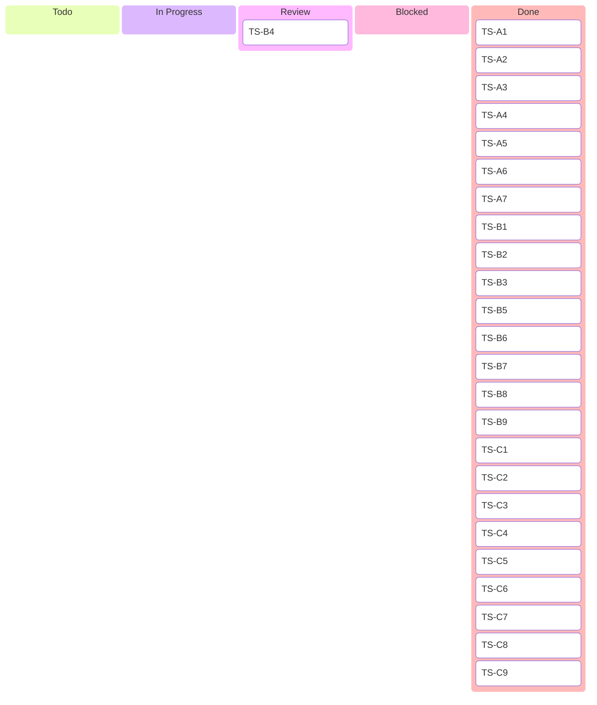

# Tasks — MCP Shield

This is the execution handoff. Each row is one behavior, small enough to implement, review and verify in one pass. Test shorthand: `S:` static or unit, `I:` integration or protocol, `E:` end-to-end or manual demo.

## 1. Status Legend

| Status | Meaning |
|---|---|
| `todo` | Ready to start |
| `in_progress` | Being implemented |
| `blocked` | Waiting on decision/dependency |
| `review` | Needs review/verification |
| `done` | Acceptance met, evidence attached |

## 2. Suggested Batching

| Wave | Purpose | Contents | Est. |
|---|---|---|---|
| `W1` | Foundation | Repo, config models, proxy pass-through, audit store + token meter | Week 1 |
| `W2` | Security value | Policy, scanner, redactor, approval, demo servers | Week 2 |
| `W3` | Visibility & polish | Dashboard pages, export, hardening, README/demo | Week 3 |

## 3. Backlog Status View



## 4. Canonical Task Table

| Ref | Wave | Status | Depends on | Source refs | Change | Stacks | Tests | Smoke | Acceptance | Evidence |
|---|---|---|---|---|---|---|---|---|---|---|
| `TS-A1` | W1 | done | – | MP-A5 | **problem:** no repo<br>**goal:** uv project, ruff/mypy/pytest, CI, Makefile | uv, GH Actions | S: lint, types<br>I: –<br>E: – | Given a fresh clone, when `make check`, then all checks pass | CI green; badge in README | CI run link |
| `TS-A2` | W1 | done | A1 | MP-B1, IP config | **problem:** no typed config<br>**goal:** Pydantic models + loader for servers/policy/shield YAML with line-numbered errors | Pydantic, PyYAML | S: unit valid/invalid<br>I: –<br>E: – | Given a bad `transport`, when loading, then error cites line 4 | Env var `${}` expansion works; JSON Schema exported | Test output |
| `TS-A3` | W1 | done | A2 | MP-B1, IP-A1, IP-A2, IP-A12 | **problem:** no proxy<br>**goal:** low-level `Server` (SDK v2) serving both protocol revisions; aggregate list/call across N upstreams with `{config_id}__tool` names; validate upstream tools and arguments (IP-A13) | mcp SDK v2, anyio | S: router unit<br>I: in-memory modern + `mode="legacy"` client ↔ Shield ↔ 2 upstreams; malformed upstream tool dropped<br>E: Claude Desktop smoke | Given `fs` and `demo`, when `tools/list`, then `fs__read_file` and `demo__echo` appear | list/call for tools, resources, prompts; upstream errors mapped | Test + screenshot |
| `TS-A4` | W1 | done | A3 | IP-A11 | **problem:** notifications dropped<br>**goal:** implement the IP-A11 matrix: forward progress, cancelled and change notifications; answer legacy `ping` locally; refuse upstream sampling, elicitation and roots requests | mcp SDK v2 | S: –<br>I: protocol tests per message type, on both revisions<br>E: – | Given an upstream sends `sampling/createMessage`, then it gets an error and a `backchannel_refused` finding is recorded | Pass-through matrix in docs is fully green | Test output |
| `TS-A5` | W1 | done | A2 | MP-B6, MP-C2, IP-A5, IP-A10 | **problem:** no audit<br>**goal:** SQLite schema (connections, requests with `logical_call_id` + `protocol_version`, token_usage, findings, policy_versions, upstreams, tool_pins) + migrations, async queue logger, JSONL spool + back-fill | SQLModel, SQLite | S: record builder<br>I: 1,000 mixed requests → 1,000 rows; DB locked → spool → back-fill<br>E: – | Given DB is read-only, when 10 requests, then 10 spool lines and 10 rows after restart | Zero dropped records; WAL mode | Count assertion |
| `TS-A6` | W1 | done | A5 | MP-C1, IP-B1 | **problem:** token cost unknown<br>**goal:** `Tokenizer` protocol (tiktoken, provider, char/4) + meter for request (once per logical call), response (content only) and schema (per-turn snapshot) tokens + pricing | tiktoken | S: counts for text/image/structured<br>I: calibration vs provider (skip without key)<br>E: – | Given a 1,000-word result, when metered, then `response_tokens` ≈ 1,300 ± 10% | Every row has `tokenizer` + `estimated=true`; >32 KB counted off-loop | Calibration report |
| `TS-A7` | W1 | done | A3, A5, A6 | MP-B6 | **problem:** pipeline stages not wired<br>**goal:** `RequestContext` + ordered pipeline (IP steps 1–13) with latency per stage | – | S: stage order unit<br>I: every request audited incl. errors<br>E: – | Given an upstream timeout, then the audit row has verdict `error` + latency | p95 overhead ≤ 25 ms on echo bench | Bench output |
| `TS-B1` | W2 | done | A7 | MP-B2 | **problem:** no access control<br>**goal:** policy engine: match server/tool globs, arg rules, rate limits, `require_approval`, worst-of verdict | – | S: rule matching table tests; clock-injected rate limit<br>I: deny over protocol<br>E: – | Given `deny-write-outside-sandbox`, when writing `/etc/passwd`, then block with rule ID | Policy hash stored per row | pytest report |
| `TS-B2` | W2 | done | B1 | MP-B2, J5 | **problem:** restart to change policy<br>**goal:** file watcher hot reload, atomic swap, invalid = keep old; `shield check-policy` | watchfiles, Typer | S: –<br>I: invalid YAML keeps old hash<br>E: – | Given a policy edit, when saved, then the next request carries the new hash | `policy_versions` appended | Test output |
| `TS-B3` | W2 | done | A7 | MP-B3 | **problem:** poisoned descriptions reach the model<br>**goal:** heuristic rule pack for descriptions + results (ignore-previous, exfil instructions, hidden unicode/zero-width, markdown image exfil, tool shadowing) | – | S: positive + negative per rule<br>I: 12 attack fixtures + 50 benign<br>E: – | Given an `evil` description, when `tools/list`, then the tool is hidden and a finding recorded | ≥ 12/12 attacks caught; ≤ 2/50 benign flagged | Precision/recall table |
| `TS-B4` | W2 | review | B3 | MP-B3 | **problem:** heuristics miss paraphrases<br>**goal:** optional ONNX classifier stage behind config flag | onnxruntime | S: threshold logic<br>I: fixtures with classifier on<br>E: – | Given classifier enabled, when paraphrased injection, then warn | Off by default; adds ≤ 15 ms p95 | Bench + test |
| `TS-B5` | W2 | done | A7 | MP-B4, MP-C3 | **problem:** secrets leak into context/logs<br>**goal:** redactor for API keys, JWT, private keys, AWS, email, phone; runs before response + audit | detect-secrets patterns | S: rule tests<br>I: grep audit DB for raw fixtures = 0 hits<br>E: – | Given a result with `AKIA…`, then client + DB see `[REDACTED:aws_key]` | No raw secret in DB | Test output |
| `TS-B6` | W2 | done | B1, A5 | MP-B5, IP pipeline step 5 | **problem:** destructive calls run unattended<br>**goal:** approval via `Resolve` + `Elicit` (multi-round-trip on 2026-07-28, live elicitation on legacy); sealed `request_state` with args hash and 5 min expiry; both legs linked by `logical_call_id` | mcp SDK v2 | S: seal/verify, expiry, args mismatch<br>I: modern + legacy client accept/decline/no-capability; tampered state rejected<br>E: Claude Desktop dialog | Given `merge_pull_request`, when the user declines, then leg 2 has verdict `denied` and nothing reaches upstream | 2 rows, 1 `logical_call_id`; args counted once; `approval_ms` recorded | Screen recording |
| `TS-B7` | W2 | done | A6, B1 | MP-C1, IP-B1 | **problem:** oversized outputs bloat context<br>**goal:** per-call budget warn/truncate with audit pointer | – | S: truncate boundary<br>I: 20k-token result truncated<br>E: – | Given budget 4,000, when a 12k result arrives, then truncated + finding | Truncation message per DG-C1 | Test output |
| `TS-B8` | W2 | done | B3, B5, B6 | MP-B8 | **problem:** nothing to demo<br>**goal:** benign + poisoned demo servers, attack fixtures, `make demo`, Claude Desktop config | Docker compose | S: –<br>I: demo script asserts expected verdicts<br>E: full demo walkthrough | Given `make demo`, when the script runs, then 1 block, 1 warn+redact, 1 approval | Boots in < 60 s; image includes CA certificates (`httpx2` uses the OS certificate store) | GIF |
| `TS-B9` | W2 | done | A3, A5 | MP-B3, MP-C7, MP-C9, IP-A16, IP-A17 | **problem:** upstreams can impersonate, mislabel, or silently change tools<br>**goal:** prefix from config id only; tool pinning + rug-pull detection with `on_change` policy; annotations can only tighten | – | S: hashing, prefixing, annotation rules<br>I: `rugpull_server` mutates a description → `tool_changed`; upstream claiming `serverInfo.name="fs"` keeps its own prefix; `readOnlyHint` doesn't skip approval<br>E: rug-pull demo | Given a pinned tool, when its description changes, then the next call needs approval | P6 shows the diff | Test output + GIF |
| `TS-C1` | W3 | done | A5, A6 | MP-B7, DG P1 | **problem:** audit not visible<br>**goal:** Streamlit shell + P1 Overview KPIs, time range, health strip | Streamlit, Plotly | S: query layer<br>I: `AppTest` on seeded DB<br>E: manual | Given 5k seeded rows, when opening P1, then it renders in < 2 s | Empty state with commands | Screenshot |
| `TS-C2` | W3 | done | C1 | DG P2, P3 | **problem:** can't find/explain a request<br>**goal:** P2 explorer (URL filters, sort by tokens) + P3 detail tabs | Streamlit | S: filter builder<br>I: `AppTest` filter → rows<br>E: manual | Given `verdict=block`, then only blocked rows are listed; click → P3 shows reason | Redacted payload toggle | Screenshot |
| `TS-C3` | W3 | done | C1 | DG P4, IP-B1 | **problem:** token spend opaque<br>**goal:** P4 token analytics (by server over time, top tools, schema cost, budget breaches) | Plotly | S: aggregation SQL<br>I: totals equal SQL sum<br>E: manual | Given seeded data, then the top tool equals the SQL max of avg response tokens | "Estimated" caption visible | Screenshot |
| `TS-C4` | W3 | done | C1 | DG P5, P6 | **problem:** security posture hidden<br>**goal:** P5 events by rule; P6 upstreams, hidden tools, active policy | Streamlit | S: –<br>I: `AppTest`<br>E: manual | Given the demo run, then P5 shows the description-injection group | Hidden tools listed with reason | Screenshot |
| `TS-C5` | W3 | done | A5 | MP-B7 | **problem:** no evidence export<br>**goal:** `shield export` + UI download (CSV/JSON, redacted) | Typer | S: serializer<br>I: export row count = query count<br>E: – | Given a 24 h range, when exporting CSV, then the header has the token columns | Never includes raw payloads | File sample |
| `TS-C6` | W3 | done | A3 | MP-B1, MP-C8, IP-A14 | **problem:** remote clients unsupported<br>**goal:** Streamable HTTP face: bearer token, bind `127.0.0.1`, `Origin` + Host allowlist, client token never forwarded | mcp SDK v2 | S: –<br>I: 401 without token; 403 on foreign Origin/Host; upstream header capture shows no client `Authorization`<br>E: – | Given no token, when POST /mcp, then 401 | Works with MCP Inspector on both revisions | Test output |
| `TS-C8` | W3 | done | A5, C5 | MP-B7 | **problem:** the agent can't ask about its own audit<br>**goal:** optional read-only `shield_list_requests`, `shield_get_token_usage`, `shield_list_security_events` (mcp-builder conventions) + 10-question evaluation XML | mcp SDK v2 | S: pagination, formats<br>I: `outputSchema` validated; cursor and `has_more`<br>E: evaluation run | Given the seeded DB, when asked for the top tool by response tokens, then the tool name matches SQL | `readOnlyHint: true`; `limit` default 20 / max 100; markdown + json formats | Eval report |
| `TS-C9` | W3 | done | A7 | MP-B9 | **problem:** Shield decisions are invisible to tracing tools<br>**goal:** add verdict, rule IDs, tokens and upstream attributes to the SDK's built-in OpenTelemetry spans | opentelemetry-sdk | S: attribute builder<br>I: in-memory span exporter shows attributes on `tools/call` spans<br>E: – | Given an OTLP exporter, when a call is blocked, then its span has `shield.verdict=block` | No cost when no exporter is configured | Test output |
| `TS-C7` | W3 | done | all | MP success markers | **problem:** project not recruiter-ready<br>**goal:** README (GIF, architecture, quickstart, security notes, precision/recall), retention job, coverage ≥ 85% on core | – | S: coverage gate<br>I: –<br>E: fresh-machine demo | Given a new laptop, when following README, then the demo works in < 5 min | All success markers measured | README link |

## 5. Expanded Task Detail

### `TS-A3` Proxy spike & aggregation

```md
task_ref: TS-A3
source_refs: MP-B1, IP-A1, IP-A2, IP-A11, IP-A12
problem: Shield must be server-to-client and client-to-N-upstreams at once without losing protocol fidelity
goal: Working aggregation for tools/resources/prompts with namespaced names
stacks_used: mcp SDK, anyio
test_plan: S: router unit; I: in-memory transports (client ↔ shield ↔ 2 upstreams); E: Claude Desktop
smoke_example: Given fs + demo upstreams, when tools/list, then fs__read_file and demo__echo appear
acceptance_criteria: list/call parity on both protocol revisions; denials as is_error results; one upstream down or malformed does not break others
depends_on: TS-A2
notes: Decided: low-level Server (SDK v2). MCPServer (formerly FastMCP) doesn't suit dynamic tool lists, and SDK middleware is provisional (timing only). Remember v2 does not validate arguments but does validate outgoing results.
```

### `TS-A6` Token meter

```md
task_ref: TS-A6
source_refs: MP-B6, MP-C1, MP-C6, IP-B1
problem: Nobody knows how many context tokens each MCP server/tool costs
goal: Accurate (±10%) per-request token usage persisted with every audit row
test_plan: S: text/image/structuredContent counting; I: calibration vs provider count_tokens (skipped w/o key)
smoke_example: Given tools/list from fs (12 tools), then schema_tokens > 0 and stored per server in upstreams
acceptance_criteria: tokenizer pluggable; fallback flagged; >32 KB payloads counted in a thread
depends_on: TS-A5
```

### `TS-B6` Multi-round-trip approval

```md
task_ref: TS-B6
source_refs: MP-B5, IP pipeline step 5, UJ-C4, DG-C1
problem: 2026-07-28 removes server-to-client requests, so approval can't be a push-and-wait
goal: One approval implementation that works for modern (InputRequiredResult + retry) and legacy (live elicitation) clients
stacks_used: mcp SDK v2 (Resolve, Elicit, RequestStateSecurity)
test_plan: S: seal/verify/expiry; I: both client modes x accept/decline/no-capability/tamper; E: Claude Desktop
smoke_example: Given a modern client, when it calls merge_pull_request and approves, then two rows share one logical_call_id and the upstream is called once
acceptance_criteria: expired or tampered state never forwards; args counted once; approval_ms recorded
depends_on: TS-B1, TS-A5
notes: The default seal key is per process, which is fine for v1 (one process). Configure keys before running several HTTP workers.
```

## 6. Evidence Log

| Ref | Evidence summary | Location |
|---|---|---|
| `TS-A1` | uv project, ruff (lint + format), mypy `--strict`, pytest, `make check` green locally. First GitHub Actions run green on 2026-11-20: `check` and `docker` jobs ([run 44741980696](https://github.com/AmanMansoori14/mcp-shield/actions/runs/44741980696)); CI badge in README | `Makefile`, `.github/workflows/ci.yml` |
| `TS-A2` | Pydantic models for shield/servers/policy/pricing YAML; `${VAR}` / `${VAR:-default}` expansion; errors cite `file:line`; JSON Schema export (`shield schema`); `shield check` exits 2 on errors | `src/mcp_shield/config.py`, `tests/unit/test_config.py` |
| `TS-A3` | Low-level SDK v2 `Server` serving 2026-07-28 and legacy clients; `{config_id}__tool` namespacing; argument validation against upstream schemas; per-upstream isolation (down, degraded, unexposable names dropped). Every integration test runs on both protocol revisions | `src/mcp_shield/proxy/`, `tests/integration/test_proxy.py` |
| `TS-A4` | Progress relayed upstream → client; `ping` answered locally; upstream elicitation refused and recorded as `passthrough.backchannel_refused`; list-changed → refresh + snapshot + downstream notification; real stdio subprocess upstream | `tests/integration/test_passthrough.py` |
| `TS-A5` | SQLite WAL schema + migrations; async bounded queue; JSONL spool on full queue or DB failure; idempotent back-fill; retention cascade | `src/mcp_shield/audit/`, `tests/unit/test_audit.py` |
| `TS-A6` | `Tokenizer` protocol (tiktoken `o200k_base`, char/4 fallback); request (args), response (content only, no structured double count), schema (definitions) tokens; payloads ≥ 32 KB counted off the event loop; estimated cost from `pricing.yaml` | `src/mcp_shield/metering/`, `tests/unit/test_meter.py` |
| `TS-A7` | Ordered pipeline with pre/post stage hooks; per-stage timings; worst-of verdicts; fail-closed on internal errors; 1,000 mixed requests → 1,000 audit rows; p95 overhead < 25 ms asserted | `src/mcp_shield/pipeline/`, `tests/integration/test_audit_pipeline.py` |

| `TS-B1` | Rule engine: server/tool globs (plain or prefixed names), argument glob/not-glob/regex on normalised paths, strictest action wins, default deny, sliding-window rate limits, `destructiveHint` only tightens | `src/mcp_shield/security/policy.py`, `tests/unit/test_policy.py` |
| `TS-B2` | Validate-then-swap reload on mtime change; invalid file keeps the old policy and its hash; each version registered in `policy_versions`; requests record the live hash | `tests/integration/test_security.py::test_hot_reload_applies_without_restart` |
| `TS-B3` | 11 deterministic rules + hidden-Unicode detection over descriptions, parameter descriptions, results and arguments. **12/12 attack fixtures caught, 0/50 benign flagged** | `src/mcp_shield/security/scanner.py`, `tests/unit/test_scanner.py`, `tests/fixtures/` |
| `TS-B4` | Classifier protocol and scanner hook (adds a finding only when rules miss). No ONNX model shipped; stays in `review` | `Scanner(classifier=...)`, `test_optional_classifier_adds_finding_when_rules_miss` |
| `TS-B5` | 13 secret/PII patterns; applied to model-visible results (text, embedded resources, structured content) and to every stored payload. Payload storage now on by default | `src/mcp_shield/security/redactor.py`, `test_payloads_are_stored_only_after_redaction` |
| `TS-B6` | 2026-07-28: `InputRequiredResult` + `request_state` sealed by the SDK `RequestStateBoundary`, args-hash binding, Shield-enforced expiry, two audit rows per logical call with args counted once. Legacy: live `elicitation/create`. Forged state rejected *and* audited. Approve / deny / decline / no-capability / expired all tested on both revisions | `src/mcp_shield/security/approval.py`, `test_destructive_tool_needs_approval`, `test_forged_request_state_is_rejected_and_audited` |
| `TS-B7` | Budget stage: `warn` finding, or `truncate` text to fit with a notice naming the request ID | `test_context_budget_warns`, `test_context_budget_truncates` |
| `TS-B8` | `demo/poisoned_server.py` (poisoned description, hidden Unicode, result injection + AWS key, destructive tool, oversized output), `demo/rugpull_server.py`, attack fixtures, `make demo` run over real stdio with security events in `shield stats` | `README.md` (real output) |
| `TS-B9` | SHA-256 definition pins persisted in `tool_pins`; changed tools flagged, re-scanned and gated by `pinning.on_change`; one approval accepts the new definition; poisoned descriptions hidden; prefixes from config ids only | `src/mcp_shield/security/pins.py`, `test_benign_definition_change_requires_one_approval`, `test_rug_pull_needs_approval_then_is_accepted` |

| `TS-C1` | Streamlit shell + P1 Overview: KPIs (requests, blocked %, estimated tokens and cost, p95 Shield overhead), requests over time by status, upstream health, latest high-severity events, empty state | `src/mcp_shield/dashboard/pages.py`, `docs/assets/dashboard-overview.png`, `test_dashboard_pages_render` |
| `TS-C2` | P2 explorer (range in URL, server/verdict/search filters, sort by tokens or latency, row → detail) and P3 detail (reason, IDs, latency split, tokens, findings, redacted payload, policy, approval legs) | `docs/assets/dashboard-detail.png`, `test_request_detail_and_missing`, `test_requests_filters` |
| `TS-C3` | P4 token analytics: tokens over time by server, top tools by response tokens (colored by server), per-turn tool-definition cost, budget breaches; "estimated" caption | `docs/assets/dashboard-tokens.png` |
| `TS-C4` | P5 security events by rule with severity filter; P6 servers, tool pins (pinned / changed / hidden) and the active policy | `test_dashboard_pages_render[page_security]`, `[page_upstreams]` |
| `TS-C5` | `shield export` (CSV/JSON, paged, payloads opt-in and redacted) and the dashboard "Prepare export" button; one shared query layer for dashboard, CLI and tools | `src/mcp_shield/audit/queries.py`, `src/mcp_shield/audit/export.py`, `tests/unit/test_queries_export.py` |
| `TS-C6` | `shield run --http`: constant-time bearer check (16+ chars), Host/Origin allowlists, `127.0.0.1` default; legacy HTTP connections keyed by `Mcp-Session-Id`, 2026-07-28 traffic grouped by client + token hash; a real HTTP upstream test proves the client token is never forwarded | `src/mcp_shield/http_face.py`, `tests/integration/test_http.py` |
| `TS-C7` | README with dashboard screenshots, agent-tools and CLI sections; hourly retention + `shield prune`; coverage gate (`--cov-fail-under=85`, currently 91%) in `make cov` and CI | `README.md`, `test_retention_prunes_old_rows` |
| `TS-C8` | `shield_list_requests`, `shield_get_token_usage`, `shield_list_security_events`: read-only annotations, pagination, markdown/json, `outputSchema`, actionable errors, audit flushed before reads; 10-question evaluation with an answer key checked in CI | `src/mcp_shield/proxy/audit_tools.py`, `evals/shield_tools_eval.xml`, `tests/integration/test_audit_tools.py` |
| `TS-C9` | Verdict, rule IDs, token counts, logical call ID and a `shield.denied` event added to the SDK's span for every message; verified with an in-memory span exporter | `src/mcp_shield/telemetry.py`, `test_spans_carry_shield_decision` |

### Gap review after wave 3

A full check of the code against the PRD. Fixed items carry their test.

| # | PRD said | Status |
|---|---|---|
| 9 | Redact everything the model sees | **Fixed.** `resources/read` and `prompts/get` replies are redacted; findings recorded (`test_resource_and_prompt_replies_are_redacted`) |
| 17 | A down upstream restarts with backoff, 3 tries | **Fixed.** A lost connection (failed call or failed periodic re-list) wakes the session; reconnects with doubling backoff; gives up after 3 failed attempts in a row; a reconnect re-screens tools (`test_crashed_upstream_reconnects`, `test_gives_up_after_max_restarts`) |
| 20 | Every request audited (MP-C2) | **Fixed.** `initialize`, `notifications/initialized`, `server/discover`, `ping` and other messages are audited by a middleware (`test_every_protocol_message_is_audited`) |
| – | One connection row per client (MP-C Connection) | **Fixed (bug found during #20).** SDK v2 creates a new session object per request, so wave 1 logged one connection per request. Legacy traffic is now keyed by the SDK's `Connection`; 2026-07-28 traffic is grouped by client info + token on every transport. `list_changed` is pushed through `Connection.outbound` (`test_one_connection_row_per_client`, `test_list_changed_is_pushed_to_legacy_clients`) |
| 3 | Exact token counts via provider API; ±10% calibration | **Built, measurement pending.** `tokenizer.kind: anthropic` (cached `count_tokens`, fallback with a circuit breaker), `tokenizer.scale` for the offline estimate, and `shield calibrate`. Tested against a fake `count_tokens`; the real ±10% check needs credentials (`ant auth login` or `ANTHROPIC_API_KEY`) and one `make calibrate` run |
| 15 | `shield init` writes sample config (UJ-C1) | Open. Copy `examples/` instead |
| 16 | `shield check-policy` dry-runs attack fixtures | Open. `shield check` validates files only |
| 18 | Alert when the spool passes 100 MB | Open |
| 19 | Context budget per call *or per session* | Open. Per call only |
| 21 | Explorer filters for connection, protocol, method, min tokens; all filters in the URL | Open. Range, server, verdict, search and sort; only range and request id in the URL |
| 22 | Click an Overview KPI to drill down | Open |
| 23 | Click a security event to open the request | Open. Search by the request id instead |
| 24 | Upstreams page: diff of a changed tool's description; reason for hidden tools | Open. Status only |
| 25 | Redactor built on `detect-secrets` patterns | Different by choice: own 13 patterns |
| 26 | Tests use `pytest-asyncio` | Different by choice: anyio's pytest plugin |
| 27 | Hide the cost tile without a pricing file | Different: shows "–" |
| 28 | Proof tasks: Claude Desktop smoke, screen recordings, MCP Inspector, fresh-laptop demo under 5 min | Open (first CI run done 2026-11-20). Verified with the SDK client, curl and real stdio subprocesses only |

### Wave 3 implementation notes (deviations from the PRD)

- **README GIF** (gap #10) is now included: `docs/assets/demo.gif`, rendered by `scripts/make_demo_gif.py` from the captured output of a real demo run (`make gif`), with the raw text alongside. It is a replay of real output, not a screen recording.
- **Dashboard tables in screenshots:** Streamlit draws tables on a canvas that the headless browser doesn't paint, so the screenshots show the chart pages and the request detail. Table pages are covered by `AppTest`.
- **OpenTelemetry export** is left to the operator: Shield adds attributes to the SDK's spans but doesn't configure an exporter.
- **HTTP auth** is a static bearer token (`SHIELD_TOKEN`), as planned for v1; OAuth is not implemented.
- **Evaluation** avoids questions about totals that the agent's own (audited) `shield_*` calls would change.

### Wave 2 implementation notes (deviations from the PRD)

- **Rate limits** return an `is_error` tool result (verdict `block`) so the model can read "retry later" and back off, instead of a protocol-level `MCPError` as IP-A15 suggested.
- **Hot reload** polls the file's mtime every second instead of adding `watchfiles`.
- **TS-B4** ships the classifier hook only; no ONNX model is bundled, so it stays in `review`.
- **TS-B8 Docker compose** (gap #7) is now included: `Dockerfile` (non-root, CA certificates, locked deps, health check) and `docker-compose.yml` (shield over HTTP, dashboard, demo client; ports on 127.0.0.1). **Verified with real Docker** (Docker CLI 29.9.3 + Compose v5.7.0 on Colima, engine 29.5.2): the image builds, `shield` reports healthy, `docker compose up --exit-code-from demo demo` runs the full walkthrough over HTTP and exits 0, the dashboard container is healthy on 127.0.0.1:8501, and the services run as uid 10001 with audit data on the volume. That run found one bug (the dashboard inherited the MCP health check), now fixed. A CI job repeats the compose demo on every push.
- **Rug-pulls on 2026-07-28 upstreams** are caught by a periodic re-listing (`refresh_interval_s`, default 30 s) rather than a `subscriptions/listen` stream.
- ~~**Redaction in the model path** covers tool results only.~~ Fixed after wave 3: `resources/read` and `prompts/get` replies are redacted too (gap #9).

### Wave 1 implementation notes (deviations from the PRD)

- **Audit store uses stdlib `sqlite3`** with plain-SQL migrations instead of SQLModel. Fewer moving parts; the schema matches IP Section 4.
- **IP-A13, schema-invalid tools:** SDK v2 refuses to send *and* to receive a listing that contains an invalid tool schema, so such an upstream is marked `degraded` as a whole (others are unaffected). Per-tool dropping applies to names Shield can't re-expose (too long once prefixed, or invalid characters).
- **Provider `count_tokens` adapter** is deferred to the calibration work (TS-C7). tiktoken and the char fallback are implemented; every row records its tokenizer.
- **Payload storage was off** in wave 1, until the redactor landed in TS-B5 (now on, always redacted first).
- **List-changed from 2026-07-28 upstreams** needs a `subscriptions/listen` stream; wave 1 handles legacy notifications. Now covered by the periodic re-listing from TS-B9.
- **HTTP upstreams** had no integration test in wave 1; TS-C6 added one (`test_client_token_is_never_forwarded_to_http_upstreams`).

## 7. Gate Check Before Execution

- [x] Every task cites upstream PRD refs.
- [x] No task introduces new scope or an unapproved stack. (`watchfiles`, `onnxruntime` and `opentelemetry-sdk` are small libraries inside approved capabilities and are noted for Gate 1 review.)
- [x] Each row has a test plan and a smoke example.
- [x] Acceptance criteria are measurable.
- [x] Tasks are grouped only for order.
